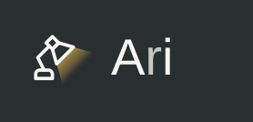
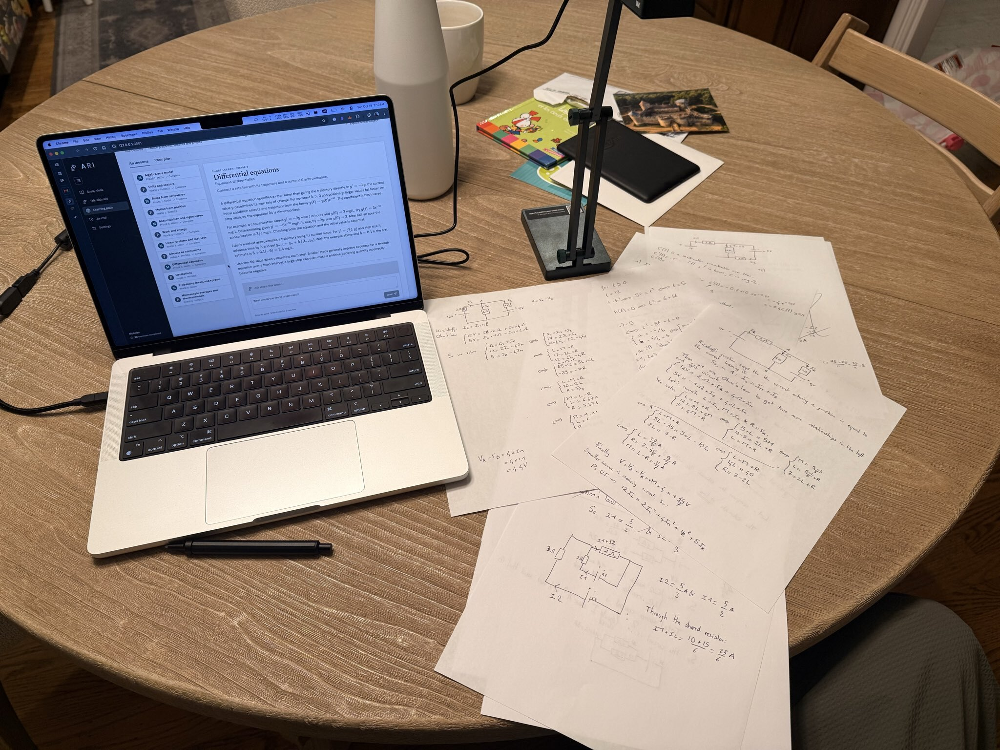
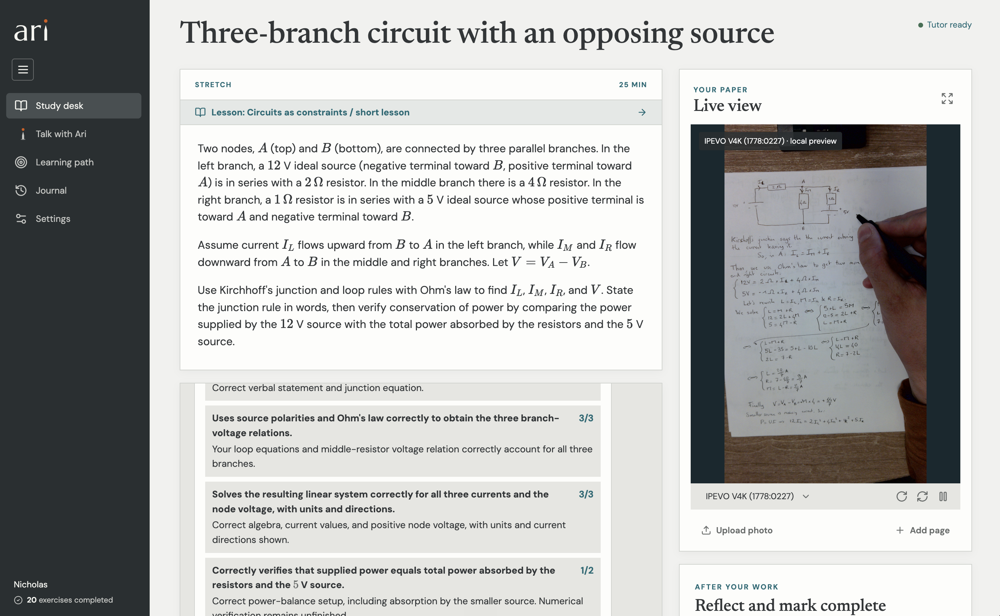

Learn stuff with pen and paper + an AI tutor.

Using pen and paper to actually solving problems is a very effective way for me to learn. It might be for you as well, and if so you might like Ari.

I recommend setting up a camera above your page, I have [this one, it works great](https://www.amazon.com/dp/B079DLTG9F).



You can then chat with Ari about what you want to learn and it will create a curriculum for you with exercises to work through.

You can ask questions while you work and when you're done, just ask it to grade your work. It can always see what you are writing.

I've had great success doing math and physics this way!

Ari runs locally right now, which allows you to use your codex subscription. I've been using that with Astra (today Anthropic doesn't let you use your subscription for non-official clients).

I recommend just pointing your AI to this repo and ask it to set it all up for you.



## Run locally

You need Node.js 24+, git, ffmpeg, and a chatGPT account. The built-in camera bridge is Mac-only, while browser cameras and photo uploads do not need it.

```sh
git clone https://github.com/nichochar/ari.git
cd ari
npm ci
npm install -g @openai/codex@0.163.0
codex -c 'cli_auth_credentials_store="file"' login
```

Complete sign in with chatGPT in your browser. Ari uses that local Codex login and your subscription's allowance, no API key needed.

```sh
cp .env.example .env
npm run build
npm start
```

Open **http://127.0.0.1:3001**.

Models are configurable in `.env`; your account must have access to the selected models.

## Make it yours

1. Open **Talk with Ari** and describe what you want to learn. For example: “Teach me photography from scratch, in 20-minute sessions.”
2. Discuss the proposed outline, then choose **Create lesson** or **Create curriculum**.
3. Use the **Study desk** to practice. Chat through anything as needed, and grade when ready. Save a reflection to help Ari adapt.

New learners start with a brief conversation.

I used a TUTOR.md for Ari's personality and a USER.md for how it learns about you. These evolve automatically but you can edit them directly or by chatting with Ari.

Want to try onboarding without resetting your progress? Run `npm run onboarding` for a separate fresh learner on port 3002. Stop that preview with `PORT=3002 npm run stop`.

## Your data

Chats, progress, uploaded materials and submitted photos are saved **on your computer**, under `.local/`, which Git ignores. Personalization lives in `~/.ari/workspace/`: `TUTOR.md` defines teaching style, `USER.md` holds learner context, and `memories/` holds detailed notes. Ari reads the two core files each turn and retrieves other notes as needed. Edit and restore the core documents in Settings; browse memories there or ask Ari to revise them. Existing learner notes and reflections are imported automatically.

Live camera preview stays local; deliberately submitted work and relevant learning context are sent to OpenAI for tutoring. This is a single-user local app—keep it on localhost.

`npm run backup` saves learning data, native conversation history and personalization files, excluding credentials. Keep its SQLite file and companion directories together. `.env`, credentials, backups and personal learning data are not included in this repository.

Personalization backups also include a matching `.workspace` directory with `TUTOR.md`, `USER.md`, memories and the workspace identity marker. To restore, stop Ari and restore the SQLite file, its `.codex` companion when present, and its `.workspace` contents to their original locations. The workspace location is saved in the database; preserve its identity marker. If backup reports that notes differ from recorded revisions, open Settings to refresh those edits and retry.

For development: `npm run dev` (UI on port 5173), `npm test`, and `npm run build`. The logo and brand rules are in [design/README.md](design/README.md).

[MIT license](LICENSE).
